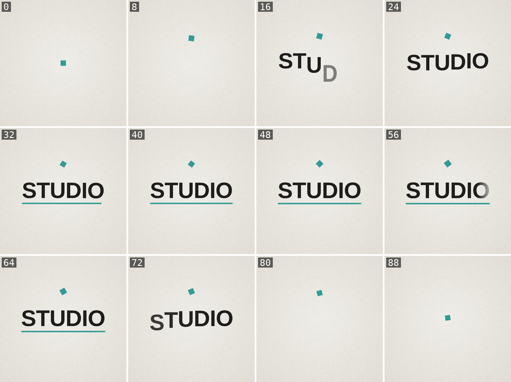

# motion-lab-grok-bot

Studio-quality motion design from code for **Grok Bot** and **Cursor**, adapted from Florence ([@flxrnc](https://x.com/flxrnc))'s article [Motion Lab](https://x.com/flxrnc/status/2105311836190978392).



## What it does

Ask the agent for an animation, a kinetic title, a product shot, a looping GIF or a short motion piece. The `motion-lab` skill:

1. turns the request into a **directed brief** (GOAL, OUTPUT, TIME, LOOK, MOTION, SHOTS, BANNED, QA) in which every adjective becomes a number,
2. writes **one self-contained HTML file** (Canvas 2D, SVG/CSS or three.js r160) or a Remotion composition, where every frame is a pure function of time,
3. **renders stills and contact sheets** with headless Chrome, looks at them, and fixes the piece with frame-numbered notes,
4. optionally **scores it in code** (Web Audio, no samples) with hits landing 1 frame after their picture, mixed to -14 LUFS,
5. exports an **X-ready MP4 and GIF** and attaches them.

## What's inside

```
.cursor-plugin/plugin.json          plugin manifest
skills/motion-lab/SKILL.md          the skill
skills/motion-lab/scripts/          render.mjs, contact-sheet, frame-diff, loop-check, audio-render, audio-hits, export, audio-check
skills/motion-lab/kit/motion.js     easing, springs, stagger, beat grid, seeded rng (pure functions of t)
skills/motion-lab/templates/        prompt template, render contract, ?t= freeze snippet, 2D / three.js / sound starters
skills/motion-lab/references/       prompt anatomy, numbers, lab loop, engines, sound, export, fixes
skills/motion-lab/examples/         title-loop (runnable), earbuds A/B, liquid-chrome, mascot (prompts + every follow-up)
```

## Requirements

- Node.js 18 or later, ffmpeg + ffprobe, Chrome or Chromium (set `CHROME_PATH` if it isn't found).
- `playwright-core` installed in the project folder you render from: `npm i -D playwright-core`. Nothing is installed globally.
- A GPU is optional; without one three.js renders in software (slower).

## Install

**Grok Bot:** install the plugin from this repository's URL (`https://github.com/plgonzalezrx8/motion-lab-grok-bot`) through Grok Bot's plugin settings.

**Cursor Marketplace:** once listed, open **Customize**, search for `motion-lab-grok-bot`, and select **Install**.

**Cursor, local test:** copy this folder to `~/.cursor/plugins/local/motion-lab-grok-bot`, then run **Developer: Reload Window** and confirm the `motion-lab` skill shows up under Customize.

## Usage

Just ask, for example:

- "Make a 5-second looping title animation for 'Blueforce' as an X-ready GIF and MP4."
- "Do a studio product shot of a matte black water bottle, 1080x1350, with sound."
- "Here's my logo SVG: animate it in, hold, and loop."

Smoke test from a scratch folder (about 20 seconds on a CPU):

```sh
S=<plugin>/skills/motion-lab
mkdir -p /tmp/ml && cd /tmp/ml && npm init -y >/dev/null && npm i -D playwright-core
node $S/scripts/render.mjs $S/examples/title-loop/index.html --seconds 4 --fps 24 --width 540 --height 540 --out out
bash $S/scripts/contact-sheet.sh out/frames out/contact.png 8
node $S/scripts/audio-render.mjs $S/examples/title-loop/sound.js --seconds 4 --fps 24 --out out/score.wav
bash $S/scripts/export.sh out/frames 24 out/title-loop out/score.wav   # out/title-loop.mp4 + .gif
```

## Credit and license

The method, the prompts, the follow-ups and the numbers come from Florence ([@flxrnc](https://x.com/flxrnc)), **"Opus 5.5 Motion Lab: Make Claude Animate Like a Studio"**, https://x.com/flxrnc/status/2105311836190978392. This plugin adapts her prompts and techniques: model-specific steps are removed, the examples are rebranded with a neutral palette, title and character, and the loop is rewritten for an agent working on a box. The scripts, starters, sound tools and the title-loop build are new. It is an independent adaptation by Pedro Gonzalez / Blueforce Innovations, not an official release by the author. Her videos and images aren't included.

Our own code is MIT-licensed (see [LICENSE](LICENSE)). [NOTICE](NOTICE) lists exactly what was adapted from the article and what's original.
